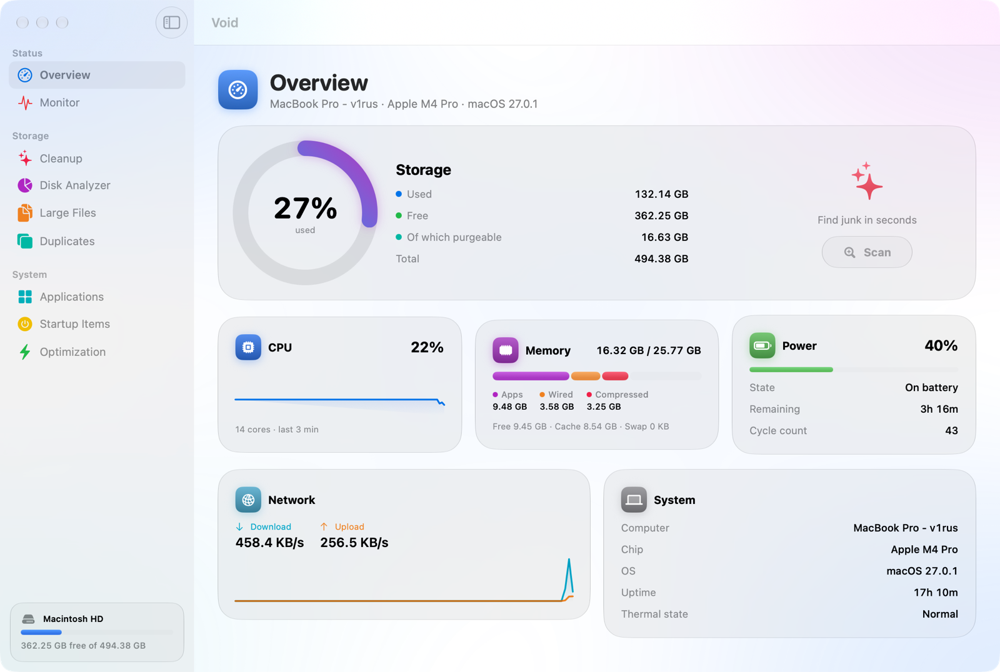
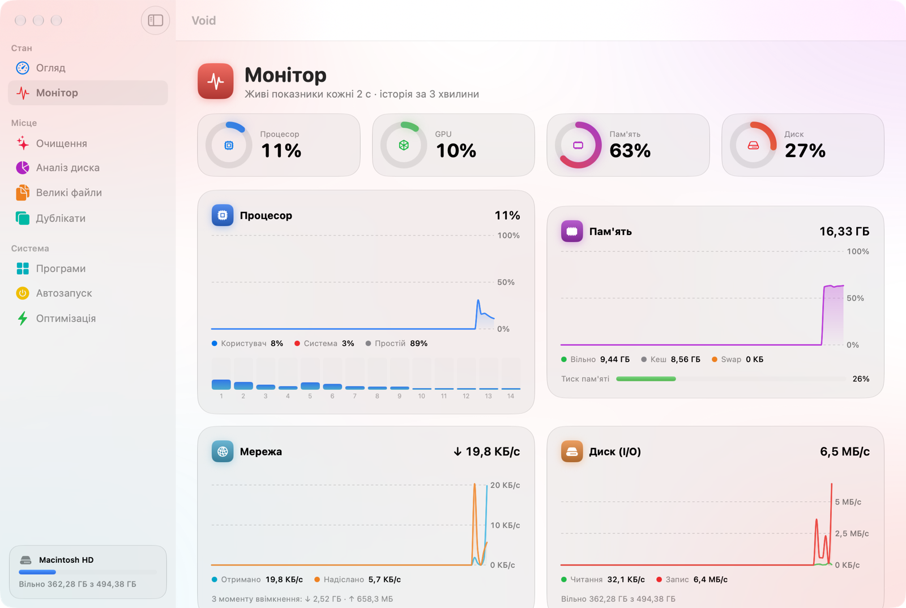
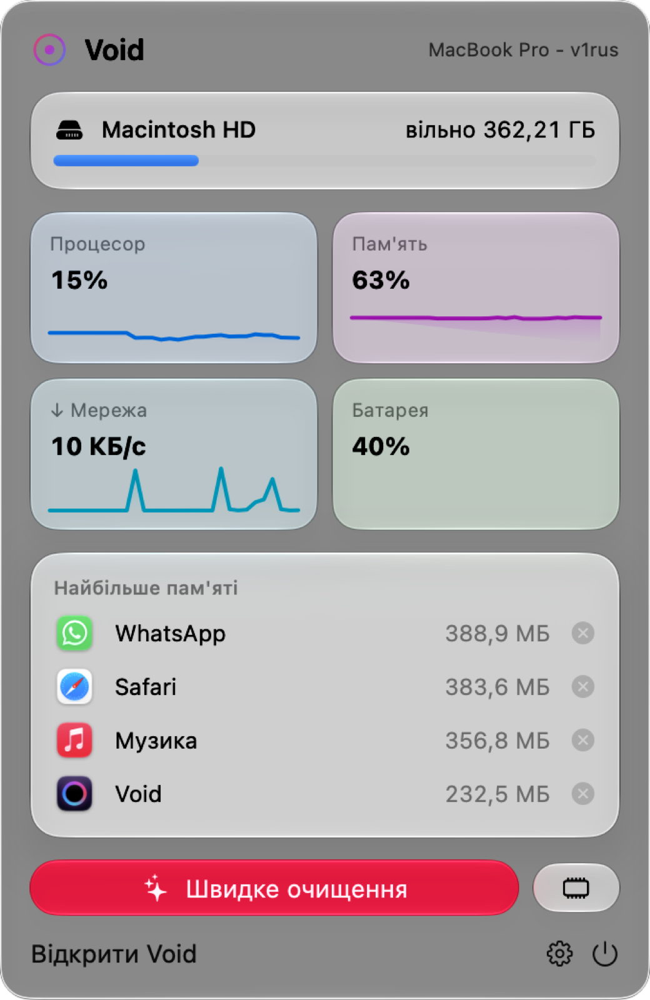

# Void

A fast, good-looking Mac cleaner and system monitor built in SwiftUI with the macOS 26/27 Liquid Glass design. The interface is available in Ukrainian and English.



## Features

- **Overview**: disk, CPU, memory, battery, network and system info at a glance.
- **Monitor**: live charts for CPU (total and per core), GPU, memory pressure and swap, network, disk I/O, load averages and top processes.
- **Cleanup**: scans 8 categories (app caches, browser caches, developer junk such as Xcode, npm, Homebrew and Gradle, logs, temp files, installers, iOS firmware and Mail, Trash) and asks you to confirm before deleting anything.
- **Disk Analyzer**: drill down into folders and see what takes up space.
- **Large Files**: finds big forgotten files and moves them to the Trash.
- **Duplicates**: finds identical files by SHA‑256 and always keeps one copy.
- **Applications**: uninstalls an app together with its leftovers (support files, caches, containers, preferences).
- **Startup Items**: turns launch agents and daemons on or off.
- **Optimization**: frees RAM, flushes DNS, thins Time Machine snapshots, rebuilds Quick Look and Launch Services, restarts the Dock and Finder, reindexes Spotlight.
- **Menu bar**: live tiles, the apps using the most memory (with a quit button) and one-click Quick Clean.
- **Low disk space alert**, launch at login, and a counter of how much space Void has freed.

<p>
  
  
</p>

## Install

Download `Void-x.y.dmg` from [Releases](../../releases), open it and drag **Void** into **Applications**.

Void isn't notarized, so allow the first launch with one of these:

- Right-click **Void.app** → **Open** → **Open**, or
- run `xattr -dr com.apple.quarantine /Applications/Void.app`.

To scan the Trash, Mail and protected caches, add Void in **System Settings → Privacy & Security → Full Disk Access**.

## Build from source

Requirements: macOS 26 or later and Xcode.

```sh
./build.sh               # builds and installs into /Applications
./scripts/package.sh     # also creates dist/Void-<version>.dmg and .zip
```

---

## Українською

**Void** — швидкий і гарний засіб очищення та моніторингу для Mac у стилі Liquid Glass. Він уміє:

- очищати кеші, логи, сміття розробника, інсталятори та Кошик;
- аналізувати диск і знаходити великі файли та дублікати;
- повністю видаляти програми разом із залишками;
- керувати автозапуском;
- показувати живі графіки навантаження;
- працювати з рядка меню.

Мову можна змінити в Налаштуваннях (⌘,).

Встановлення: завантажте DMG з [Releases](../../releases) і перетягніть Void у «Програми». Під час першого запуску натисніть правою кнопкою → «Відкрити».
